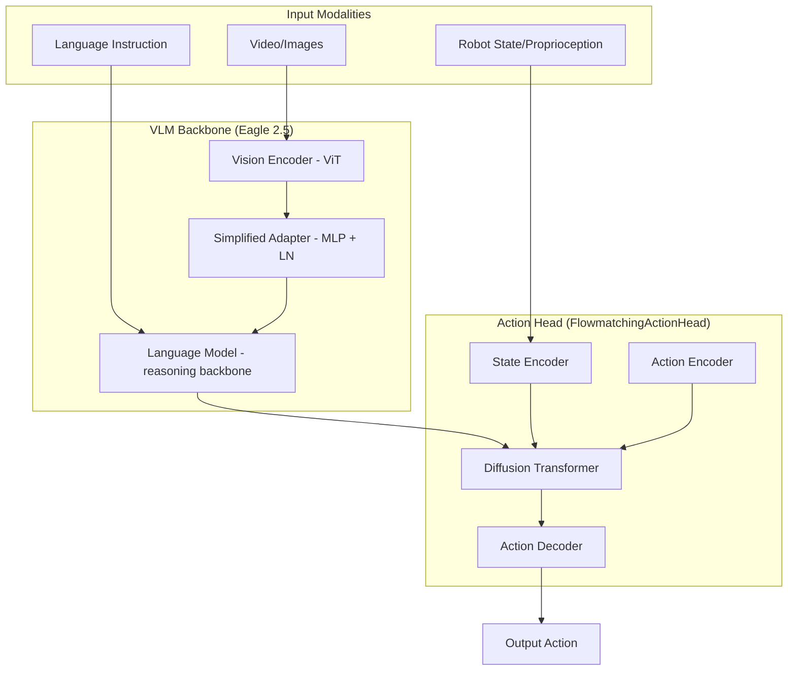

# NVIDIA Isaac GR00T N1.5 Architecture Detail

GR00T N1.5 is a general-purpose vision-language-action (VLA) foundation model designed for humanoid robots. It utilizes a modular architecture that combines a high-capacity vision-language backbone with a specialized diffusion transformer head for action generation.

## 1. High-Level Architecture
The architecture comprises two primary components:
- **Vision-Language Model (VLM) Backbone**: Encodes multimodal inputs (video, language) into a shared representation.
- **Action Head**: Generates robotic actions by denoising continuous trajectories using a Diffusion Transformer (DiT).



---

## 2. Component Details

### A. VLM Backbone (Eagle 2.5)
The backbone is responsible for high-level reasoning and grounding.
- **Model Type**: Updated to **Eagle 2.5** in N1.5, which offers superior grounding and physical understanding compared to previous versions.
- **Vision Encoder**: A Vision Transformer (ViT) that processes camera feeds.
- **Adapter**: A streamlined MLP with **Layer Normalization** connects the vision encoder to the LLM.
- **Frozen Weight Policy**: In N1.5, the VLM backbone remains **frozen** during both pretraining and finetuning. This preserves the general knowledge of the VLM and improves data efficiency.

### B. Action Head (Diffusion Transformer)
The action head translates the VLM's latent features into precise robotic motor commands.
- **Diffusion Mechanism**: Uses **Flow Matching** (a variant of continuous normalizing flows) to denoise action trajectories.
- **Transformer Architecture**: A **Cross-Attention DiT** where the latent representation from the VLM acts as the "context" or "encoder states," and the robot's state and noisy actions are the "hidden states."
- **Encoders/Decoders**:
  - **State Encoder**: A category-specific MLP that embeds proprioceptive data.
  - **Action Encoder**: The `MultiEmbodimentActionEncoder` is a critical component that projects the noisy action trajectory and diffusion time into a latent space.
    - **Inputs**:
      - **Actions ($x_t$)**: Trajectory of shape `(Batch, Horizon, Action_Dim)`.
      - **Timesteps ($t$)**: Scalar representing current "flow" time (0 to 1).
      - **Embodiment IDs**: Robot identification label.
    - **Process**:
      - **Temporal Expansion**: Replicates the scalar timestep $t$ across the entire action horizon ($T$), transforming shape `(B,)` to `(B, T)`.
      - **Sinusoidal Time Embedding**: Maps $t$ into a high-dimensional vector using sine/cosine frequencies, allowing the model to capture fine-grained denoising stages.
      - **Multi-Embodiment Projection**: Uses `CategorySpecificLinear` layers with separate weights for every `EmbodimentTag` to handle different joint configurations (e.g., 7-DOF arm vs. 30-DOF humanoid).
      - **Multimodal Fusion**: Concatenates action features and time embeddings (`[Action_Feature; Time_Feature]`) and projects them through linear layers and SiLU (Swish) activations.
    - **Purpose**: By blending "where the trajectory is" (Action) with "how far it is from the goal" (Time), it creates state tokens for every future step that the DiT refines using VLM context.
  - **Action Decoder**: Map the transformer's latent output back to the specific action space of the robot.

### C. Multi-Embodiment System
GR00T N1.5 supports a wide variety of robots through a flexible **Embodiment Tag** system.
- **Category-Specific Layers**: Instead of universal weights, these layers swap parameters based on the `EmbodimentTag` (e.g., `GR1`, `OXE_DROID`, `GENIE1_GRIPPER`).
- **Unified Action Head**: While the state/action encoders/decoders are specialized, the core **DiT block is shared** across all embodiments, facilitating cross-robot knowledge transfer.

---

## 3. Key Innovations in N1.5

### FLARE (Future Latent Representation Alignment)
GR00T N1.5 integrates **FLARE**, which enables the model to learn from human egocentric videos. It works by:
1.  Predicting the **Future Latent Tokens** of the vision-language representation.
2.  Aligning these predicted tokens with the actual representations of future video frames.
3.  This allows the model to capture high-level task progress even when direct action labels are missing (as in broad internet video data).

### Improved Data & Training
- **Synthetic Data**: Integrated **DreamGen** synthetic neural trajectories.
- **Efficiency**: Improved performance in low-data (0-shot/few-shot) regimes for novel objects and environments.

---

## 4. Latent Space Integration
The model processes a sequence of tokens in the action head:
- **State Features**: Embedded current state.
- **Future Tokens**: Predicted latent features (via FLARE).
- **Action Features**: Positional-encoded noised action trajectory.

These are concatenated and fed into the DiT, which cross-attends to the **VLM Backbone Features** (vision + language tokens) to predict the denoising velocity.

---

## 5. Deep Dive: Action Encoder

The **Action Encoder** (specifically the `MultiEmbodimentActionEncoder`) is a critical component of the Flow Matching action head in GR00T N1.5. Its primary job is to take the "noisy" action trajectory and the current diffusion "time" and project them into a latent space that the Diffusion Transformer (DiT) can understand.

### Detailed Breakdown

#### 1. Inputs to the Encoder
During either training or inference, the encoder receives three main pieces of data:
*   **Actions ($x_t$):** A trajectory of shape `(Batch, Horizon, Action_Dim)`. During training, this is a blend of pure noise and ground truth. During inference, it starts as pure Gaussian noise.
*   **Timesteps ($t$):** A scalar for each batch representing the current "flow" time (from 0 to 1). This tells the model how much noise is currently in the trajectory.
*   **Embodiment IDs**: A label identifying which robot (e.g., GR1, Agibot, or a custom one) the data belongs to.

#### 2. The Step-by-Step Encoding Process

**A. Temporal Expansion**
The timestep $t$ is initially a single number per batch item. However, the model needs to reason about this time at every single point in the action sequence. The encoder first **replicates** this scalar across the entire action horizon ($T$), transforming it từ a shape of `(B,)` to `(B, T)`.

**B. Sinusoidal Time Embedding**
Instead of feeding the raw number $t$ into the network, GR00T uses **Sinusoidal Positional Encoding**:
*   It maps the scalar $t$ into a high-dimensional vector (e.g., 512 or 1024 dims) using sine and cosine functions at different frequencies.
*   This allows the model to capture fine-grained differences between "early" and "late" denoising stages much more effectively than a raw scalar could.

**C. Multi-Embodiment Action Projection**
Because different robots have different numbers of joints, the encoder uses **Category-Specific Linear layers** (`W1`):
*   It maintains a separate set of weights for every `EmbodimentTag`.
*   During a forward pass, it "keys" into the weights corresponding to the specific robot being trained, allowing a single model to handle vastly different physical forms simultaneously.

**D. Multimodal Fusion (Concat & Project)**
The action embedding and the time embedding are then **concatenated** along the feature dimension. 
1.  **Concat:** `[Action_Feature; Time_Feature]` $\rightarrow$ Shape: `(B, T, 2 * Hidden)`.
2.  **Fusion:** This combined vector is passed through a second linear layer (`W2`) followed by a **SiLU (Swish)** activation function.
3.  **Final Output:** A final linear layer (`W3`) produces the latent tokens that are eventually fed into the DiT.

### Why is this necessary?
In a Flow Matching system, the model's goal is to predict the "velocity" needed to move the noisy actions toward the real actions.
*   The **Action Input** tells the model *where the trajectory is now*.
*   The **Time Input** tells the model *how far it is from the goal*.
*   The **Action Encoder** blends these two into a single "state token" for every step in the future trajectory, which the DiT then refines by looking at the visual and language context provided by the VLM backbone.

### Code Reference
The implementation logic in `flow_matching_action_head.py`:

```python
# From MultiEmbodimentActionEncoder.forward:
a_emb = self.W1(actions, cat_ids)                             # Project Actions
tau_emb = self.pos_encoding(timesteps).to(dtype=a_emb.dtype)  # Sinusoidal Time
x = torch.cat([a_emb, tau_emb], dim=-1)                      # Concatenate
x = swish(self.W2(x, cat_ids))                                # Fuse with Category-Specific Weights
x = self.W3(x, cat_ids)                                       # Final Representation
```

---

## 6. Deep Dive: State Encoder & Action Decoder

Both the **State Encoder** and **Action Decoder** rely on a **Category-Specific MLP** architecture. This design allows GR00T N1.5 to maintain a "universal" core while providing custom "plug-and-play" interfaces for different robot embodiments.

### Category-Specific Layers
At the heart of these components is the `CategorySpecificLinear` layer. Unlike a standard linear layer that has one set of weights, this layer holds a weight tensor of shape `(num_embodiments, input_dim, output_dim)`.
*   **Weight Selection**: During the forward pass, the layer uses the `embodiment_id` to index into this tensor, selecting the specific weights and biases for the current robot.
*   **Specialization**: This ensures that the proprioceptive data from a UniTree G1 is processed differently than that of a Fourier GR1, even though they eventually produce features in the same latent space.

### State Encoder
- **Input**: Raw robot state/proprioception (e.g., joint angles, velocities).
- **Output**: A fixed-dimension "state token" (part of the `sa_embs` sequence).
- **Purpose**: Translates physical robot measurements into the high-level language the transformer understands.

### Action Decoder
- **Input**: The final hidden states from the Diffusion Transformer.
- **Output**: The predicted denoising velocity (which is integrated into the final action $x_0$).
- **Purpose**: Maps the abstract "ideal movement" planned by the transformer back into the specific motor control space of the target robot.

---

## 7. Deep Dive: Diffusion Transformer (DiT)

The **Diffusion Transformer** is the "reasoning engine" for action generation. It is a cross-attention transformer that integrates multimodal context with the current noisy plan.

### 1. Timestep Conditioning
Because DiT must perform differently depending on whether it's at the start (high noise) or end (fine-tuning) of the denoising process, it is **conditioned on time**.
*   **Timestep Encoder**: Converts the discrete diffusion step into a high-dimensional embedding (`temb`).
*   **AdaLayerNorm**: Instead of standard LayerNorm, DiT uses **Adaptive Layer Normalization**. The scale and shift parameters for the normalization are predicted directly from the `temb`. This effectively "shifts" the entire behavior of the transformer blocks based on the current diffusion time.

### 2. Multi-Head Attention Flow
Each transformer block handles two types of information flow:
*   **Self-Attention**: The tokenized state, future latent tokens, and noisy action trajectory attend to each other to ensure temporal and physical consistency in the predicted movement.
*   **Cross-Attention**: The action tokens attend to the **VLM Backbone Features**. This is where "grounding" happens—the model looks at the visual scene and the language instruction to decide what the robot should actually do.

### 3. Latent Output
The final output of the DiT is a sequence of vectors corresponding to the action horizon. These vectors represent the **denoising velocity**. By applying this velocity over several inference steps (typically 4-8), the model "pushes" the initial noise into a coordinated, goal-directed robot trajectory.

### Code Reference (DiT Forward Pass)
From `cross_attention_dit.py`:
```python
def forward(self, hidden_states, encoder_hidden_states, timestep):
    # 1. Encode timestep into a conditioning vector
    temb = self.timestep_encoder(timestep)
    
    # 2. Process tokens through Transformer Blocks with Cross-Attention
    for block in self.transformer_blocks:
        hidden_states = block(
            hidden_states,
            encoder_hidden_states=encoder_hidden_states,
            temb=temb # AdaLayerNorm uses this
        )
    
    # 3. Final adaptive norm and projection to action space
    hidden_states = self.norm_out(hidden_states) * (1 + scale) + shift
    return self.proj_out_2(hidden_states)
```